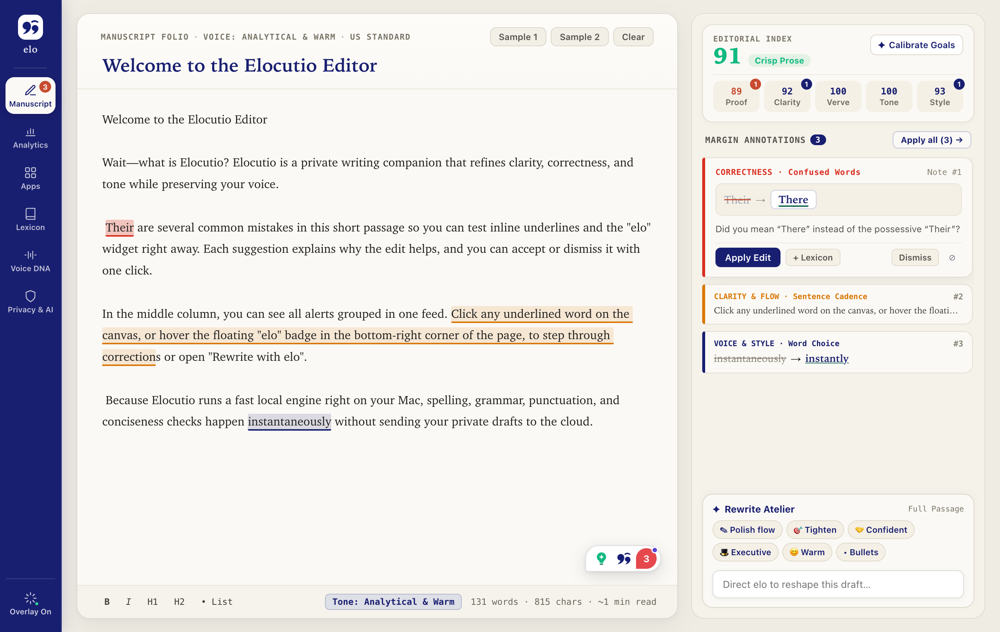

<div align="center">
  <picture>
    <source media="(prefers-color-scheme: dark)" srcset="assets/brand/lockup-white.png" />
    
  </picture>
  <h3>Your voice. Clearly expressed.</h3>
  <p>A private, open-source writing companion for macOS — with Windows, browser, iOS, and Android on the roadmap.</p>
  <p>
    <a href="https://pri-te-sh.github.io/elocutio/"></a>
    <a href="https://github.com/pri-te-sh/elocutio/actions/workflows/ci.yml"></a>
    <a href="LICENSE"></a>
    <a href="#requirements"></a>
    <a href="ROADMAP.md"></a>
    <a href="CONTRIBUTING.md"></a>
  </p>
</div>

---

**Elocutio** (el-oh-KOO-tee-oh) improves the text you are already writing — in Mail, Slack, Notes, Word, or your browser — while keeping it sounding like you. Local rules catch the obvious mistakes instantly and offline. A model you choose handles judgment: clarity, tone, and rewrites. You bring the API key (or run a local model), and your text goes only to the provider you configured.

> **Status: pre-alpha.** The macOS app builds and runs from this repository. It is built on a fork of [Harper](https://github.com/Automattic/harper) (Apache-2.0). There is no signed release yet, and breaking changes are expected. See the [roadmap](ROADMAP.md) and [progress dashboard](docs/PROGRESS.md).

<p align="center">
  
</p>

## Download

**[Download Elocutio for Mac](https://github.com/pri-te-sh/elocutio/releases/latest/download/Elocutio-macOS.dmg)** — one DMG for Apple silicon and Intel, macOS 14 or later. Every version is on the [releases page](https://github.com/pri-te-sh/elocutio/releases).

1. Open the DMG and drag **Elocutio** to **Applications**.
2. Open Elocutio. Pre-alpha builds are not notarized yet, so if macOS says it cannot verify the app, open **System Settings → Privacy & Security** and click **Open Anyway** (once).
3. Allow **Accessibility** when asked, so Elocutio can read and edit the field you are typing in.
4. Add an API key in Elocutio Studio → Privacy & AI, or choose Ollama or Apple's on-device model.

## What works today

**In every app (the `elo` overlay)**

- Spelling, grammar, and style underlines in native and web text fields, checked locally by Harper.
- Hover an underline for a one-click fix. When a sentence has several issues, a **Correct the sentence** card shows the whole corrected sentence as an inline diff and applies it in one edit.
- Select text to get a small pill under the selection: **Rewrite selection** or **Suggestions**. A rewrite replaces only the selected text.
- Edits touch only the affected text and never steal focus from the app you are typing in.
- Shortcuts: rewrite the selection (`⌥⌘E`), analyze the field (`⌥⌘A`), undo the last edit (`⌥⌘Z`).

**In Elocutio Studio**

- A manuscript editor with live local checks, AI paragraph rewrites, and a feed of editorial notes.
- Writing analytics: a writing score, readability, AI usage, and cost per model.
- Per-app on/off controls, a personal dictionary, and rule overrides.
- **Voice DNA:** a local style profile learned from your samples and the edits you accept.

**Providers:** OpenRouter, OpenAI, Groq, Ollama (local or cloud), any OpenAI-compatible endpoint, and Apple's on-device Foundation Model (macOS 26) through a built-in local bridge.

**Privacy:** your dictionary, settings, usage, and voice profile stay in `~/Library/Application Support/elocutio/`. API keys are stored only in the macOS Keychain, one per provider host, so a key saved for one provider is never sent to another. Local-only mode keeps everything on the Mac, and a network log in Settings lists the provider requests that left it.

See [`docs/M0-VERIFICATION.md`](docs/M0-VERIFICATION.md) for the tested app matrix and known limitations.

## Why Elocutio

Grammarly is excellent, but it is closed, subscription-based, and cloud-only. Three things have changed:

1. **Writing quality is available through an API.** An inexpensive model can proofread, rewrite, and explain edits well.
2. **Local models are good enough for short text.** Harper checks English on-device in milliseconds; Apple's Foundation Model and Ollama cover private rewrites.
3. **People want control** over which model they use, what leaves their machine, and what it costs.

Grammarly has no documented offline mode, and its enterprise "BYOK" means bring-your-own-**encryption**-key, not bring-your-own-model. Elocutio is the opposite: **local-first, model-agnostic, no vendor in the middle.**

## How it works

```text
┌──────────────────────── Tauri app (Rust + Svelte) ────────────────────────┐
│  Menu bar · Studio window · settings · SQLite · Keychain                  │
│  Providers: OpenRouter / OpenAI-compatible / Ollama / Apple on-device     │
│  Analysis: chunk → prompt → validate → resolve offsets → dedupe           │
│  Voice: samples → style card → prompt                                     │
├────────────────────────────────────────────────────────────────────────────┤
│  elo overlay (in-process, non-activating window)                          │
│  Accessibility read → Harper local rules → underlines, cards, pill        │
│  Writes: select span → replace → verify, with a pasteboard fallback       │
└────────────────────────────────────────────────────────────────────────────┘
```

- **Reads** use the macOS Accessibility API. **Writes** select exactly the affected span and replace it, verify the result, and fall back to a clipboard-safe paste for apps that ignore Accessibility writes.
- **The overlay never takes keyboard focus**, because stealing focus would break the paste and the app you are typing in.
- **Distribution:** the release target is a non-sandboxed, Developer ID-signed, notarized app. The Mac App Store is not an option, because App Sandbox cannot read other apps' text.
- **Unsupported:** Google Docs, because it draws text on a canvas. Gmail, Notion, Slack, and Linear will be covered by the browser extension.

The shared logic lives in platform-agnostic Rust crates; each platform gets a thin shell. More detail: [architecture](docs/ARCHITECTURE.md) · [privacy](docs/PRIVACY.md) · [voice design](docs/VOICE-LEARNING.md).

## Providers and cost

OpenRouter is the default because one key reaches many models. Settings → Privacy & AI switches to any preset or to a custom OpenAI-compatible base URL.

| Task | Default | Escalation |
| --- | --- | --- |
| Proofread / clarity | `anthropic/claude-haiku-5.5` | `claude-sonnet-5` |
| Rewrite / compose / translate | `anthropic/claude-haiku-5.5` | `claude-sonnet-5` → `gpt-5.6-sol` |
| Budget mode | `deepseek/deepseek-v4.1-flash` | — |
| Local | Apple Foundation Model (macOS 26) or Ollama | — |

There is no markup and no credit system: you pay your provider directly. At October 2026 prices the default costs roughly **$0.28 per 1,000 email reviews**. Local mode is free. An optional per-request cost cap applies to every request.

## Voice learning

Elocutio does not fine-tune a model on your writing. It builds a local, explainable **voice profile** from samples you paste and, if you opt in, the edits you accept. A compact style card is added to rewrite prompts only when **Use my voice** is on. Both learning and use are **off by default**, raw samples are never stored, and clearing the profile deletes everything it learned. See [VOICE-LEARNING.md](docs/VOICE-LEARNING.md).

## Platforms

| Platform | Status | Approach |
| --- | --- | --- |
| **macOS** | **v1 target** | Tauri + Accessibility overlay, menu-bar app |
| **Chrome/Edge** | Planned (M3) | Manifest V3 extension + local bridge |
| **Windows** | After v1 | Tauri + UI Automation |
| **iOS / Android** | Planned | Native apps with keyboard / accessibility extensions |

Milestones and scope: [ROADMAP.md](ROADMAP.md) and [docs/PLAN.md](docs/PLAN.md). Feature-by-feature targets: [docs/FEATURE-MATRIX.md](docs/FEATURE-MATRIX.md).

## Requirements

- macOS 14 Sonoma or later
- Accessibility permission (needed to read and edit text in other apps)
- An API key for a supported provider, or a local model (Ollama, or Apple's on-device model on macOS 26)
- For development: Xcode Command Line Tools, Rust 1.98+, Node.js 22+, pnpm 11+, Python 3.11+, and [`just`](https://github.com/casey/just)

## Development

```bash
git clone git@github.com:pri-te-sh/elocutio.git
cd elocutio
./scripts/bootstrap.sh   # check tooling, install JS deps, run tests
just check               # workspace: fmt + clippy + tests + docs + prettier
just macos-check         # macOS app: type-check, build, clippy, tests
just macos-dev           # run the app in development mode
just macos-build         # build a debug Elocutio.app
just macos-release       # build an optimized app + DMG
```

**Keeping permissions across rebuilds.** macOS ties the Accessibility grant (and Keychain access) to the app's signature. An unsigned debug build gets a new signature every time, so the grant is lost on every rebuild. Sign debug builds with a local identity to keep it:

```bash
security find-identity -v -p codesigning     # list your signing identities
just macos-build-signed "Apple Development: Your Name (TEAMID)"
```

No Apple Developer identity? `just dev-cert` creates a stable self-signed one.

**Releases.** Pushing a version tag (`git tag v0.1.0 && git push origin v0.1.0`) runs the [release workflow](.github/workflows/release.yml): it builds a universal app, packages `Elocutio-macOS.dmg` with `scripts/package-macos.sh`, and publishes it to GitHub Releases. With Developer ID secrets configured it also signs and notarizes the app; see [MAINTAINING.md](docs/MAINTAINING.md#releases). The [progress dashboard](docs/PROGRESS.md) tracks milestones from repository evidence (`just progress-serve`).

## Repository layout

```text
.
├── apps/macos/          # macOS app: Tauri (Rust) + Svelte, forked from Harper
├── apps/{windows,ios,android}/   # future platform shells (planned)
├── crates/
│   ├── elocutio-core/       # suggestion model and domain types
│   ├── elocutio-analysis/   # chunking, prompts, span resolution, merging, tone
│   ├── elocutio-llm/        # provider adapters, model catalog, streaming, errors
│   ├── elocutio-voice/      # voice profiles, style cards, copy guard
│   ├── elocutio-store/      # storage types
│   ├── elocutio-bridge/     # browser-extension protocol
│   └── elocutio-platform/   # shared capture/injection/overlay traits
├── vendor/harper/       # vendored harper-core subset (Apache-2.0)
├── extensions/chrome/   # MV3 extension (planned)
├── assets/              # brand sources, icons, screenshots, site media
├── docs/                # plan, architecture, privacy, testing, decisions
├── progress/            # build-progress ledger and dashboard
└── scripts/             # bootstrap, docs check, signing, upstream fetch
```

## Documentation

- [Executive brief](docs/EXECUTIVE-BRIEF.md) — findings, scope, timeline, and costs in two pages
- [Product audit](docs/AUDIT.md) — what Grammarly/Superhuman ships and where the gap is
- [Build plan](docs/PLAN.md) · [Architecture](docs/ARCHITECTURE.md) · [Decision records](docs/DECISIONS.md)
- [Privacy](docs/PRIVACY.md) · [Security](SECURITY.md) · [Testing](docs/TESTING.md)
- [Voice learning](docs/VOICE-LEARNING.md) · [Prompt library](docs/PROMPTS.md) · [Brand](docs/BRAND.md)
- [Maintaining](docs/MAINTAINING.md) · [Research notes](research/)

## Contributing

The most useful contributions right now are product feedback, testing in real apps, and prompt/evaluation work, as well as code. See [CONTRIBUTING.md](CONTRIBUTING.md).

- Open an issue before a large pull request.
- Sign off your commits (`git commit -s`) under the [DCO](https://developercertificate.org/); contributions are licensed under Apache-2.0.
- Follow the [Code of Conduct](CODE_OF_CONDUCT.md), and report vulnerabilities privately per [SECURITY.md](SECURITY.md).

## License and attribution

Elocutio is licensed under **Apache-2.0**. It is derived from [Harper](https://github.com/Automattic/harper), Copyright (c) Automattic, also Apache-2.0. See [LICENSE](LICENSE) and [NOTICE](NOTICE).

Elocutio is not affiliated with, endorsed by, or sponsored by Automattic, Grammarly, Inc., or Superhuman. "Grammarly" and "Superhuman" are trademarks of their owners and are used here only for descriptive comparison. The Elocutio name is provisional pending trademark clearance.
